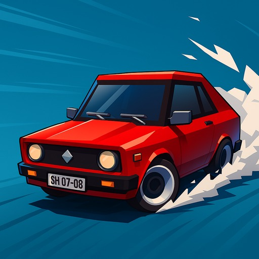
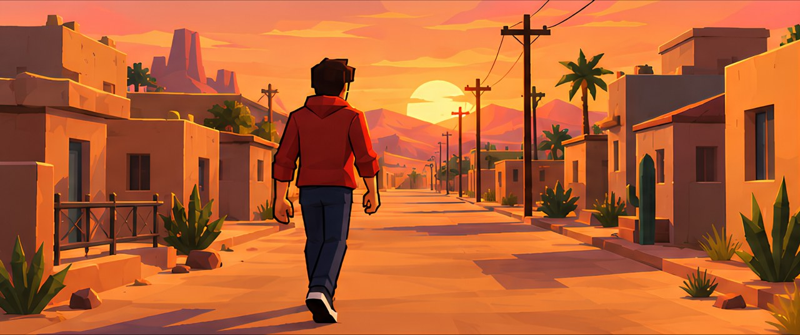
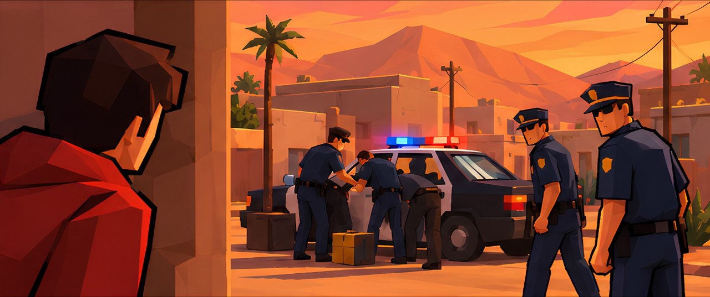
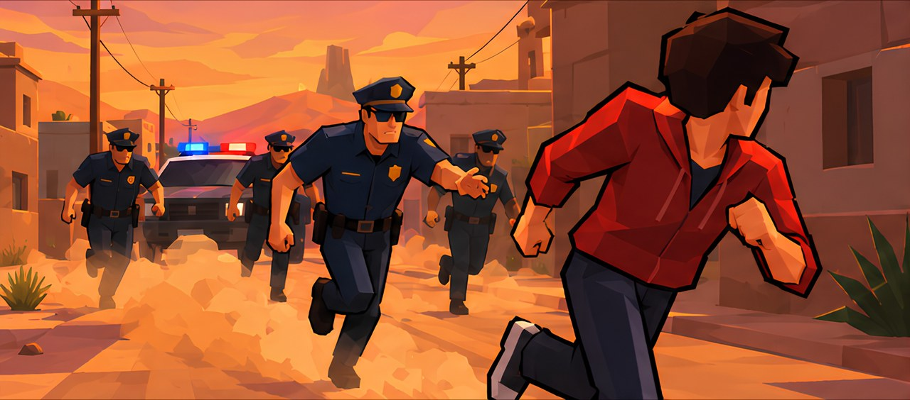

<div align="center">
  

  <h1>BOMB COPS</h1>

  <p><strong>Drift. Bomb. Bribe.</strong></p>

  <p>
    A top-down desert pursuit game about momentum, nerve, and the price of freedom.<br />
    Built for <strong>Game Jam+ 2026</strong> with Unity 6 and URP.
  </p>

  <p>
    
    
    
    
  </p>

  <p>
    <a href="#overview">Overview</a> &middot;
    <a href="#features">Features</a> &middot;
    <a href="#how-a-run-works">The Run</a> &middot;
    <a href="#controls">Controls</a> &middot;
    <a href="#play-the-build">Play</a> &middot;
    <a href="#under-the-hood">Tech</a>
  </p>
</div>

> You weren't supposed to see the crate. Now every cruiser in the desert is on your bumper.

---

## Overview

**Bomb Cops** is an arcade survival game about a getaway gone sideways. You drive a red hatchback that never stops accelerating, while an increasingly aggressive police force tries to box you in, ram you off the road, and end the chase for good.

You have no guns - only a limited supply of bombs and a good sense of timing. Lead the cops into an explosive trap, collect the bounty, and keep moving. Every wreck pays. Every second raises the heat. And if you survive long enough to afford it, there may be a way to buy your way out of the desert entirely.

The game is built around a simple question: **cash out now, or push your luck for one more wave?**

### The setup

A quiet evening, a shortcut through the wrong part of town, and a crate that was never meant to be seen. Five comic panels set the scene before the sirens start.

<p align="center">
  
  
  
</p>

---

## Features

- **Drift-first driving.** A custom Rigidbody vehicle model with automatic throttle, smoothed steering, and a lateral-grip system tuned for slides. The car always moves forward - steering, momentum, and drift control are the whole game.

- **Bombs are your only weapon.** Grab floating bomb pickups, watch the direction indicator, and drop explosives in the path of a pursuing cruiser. A direct hit sends the car flying, triggers an explosion, and pays out **$100**.

- **A five-stage pursuit.** Five police units join the chase over the course of a run, each with its own acceleration, top speed, turn rate, and handling profile. The first cruiser is manageable. The last one is not.

- **A wanted system that escalates.** Every new wave adds a wanted star, an intro card, and a fresh line of radio chatter. The desert stays the same; the pressure does not.

- **Greed is the difficulty curve.** Destroyed cruisers respawn and rejoin the chase. The longer you stay alive, the more money you can make - and the more chances you give the police to take you down.

- **A real finish line.** The bribe costs **$30,000**. Cash is saved between runs, even when you die, so every failed escape is progress toward the ending. Pay the cops off, or start a new game and try again.

- **Arcade presentation.** Drift trails, tire smoke, camera shake, pooled explosions, animated UI, engine and tire audio, and a comic-book intro.

- **Keyboard, gamepad, and touch.** Full Input System support, including on-screen steering and bomb buttons for touch devices.

- **Pick-up-and-play flow.** A short comic intro, a Start screen, a pause menu, a game-over screen, and an ending scene - the complete jam-sized loop.

---

## How a run works

1. **Start the engine.** The car accelerates automatically. Use the steering controls to keep it on the road and away from the closing police net.
2. **Find a bomb.** The pickup spawns at a random point in the play area. A direction arrow and distance readout guide you toward it.
3. **Set the trap.** Drop a bomb and steer clear. If a police car hits it, the cruiser is launched, explodes, and pays out.
4. **Survive the escalation.** New police units arrive roughly every 30 seconds, each announced with a wanted star and a short radio exchange.
5. **Decide what freedom is worth.** If you go down, you can restart and keep your cash - or pay the **$30,000** bribe and reach the ending.

> [!TIP]
> Momentum is your handbrake. A sharp drift can bait a cruiser into oversteering, giving you a clean line for a bomb drop.

---

## Controls

The car has no brake and no reverse. Steering and drift management are the entire control scheme.

| Action | Keyboard | Gamepad | Touch |
| :--- | :--- | :--- | :--- |
| Steer left / right | `A` / `D` | `LB` / `RB` | On-screen left / right buttons |
| Drop bomb | `Space` | South face button (`A` / `Cross`) | Bomb button |
| Pause / resume | `Esc` | `Start` | - |
| Start a run | Start button | - | Start button |
| Restart after death | Restart button | - | Restart button |

**Tips**

- The steering input is smoothed, so small taps are often better than holding a direction.
- Bombs sit behind the car after they are dropped. Lead a pursuer into them rather than dropping at the last second.
- The health bar starts at **10**. Each police collision costs **1** health. Watch for the low-health smoke.
- Leaving the play area starts a 3-second out-of-bounds countdown before the car is reset.

---

## Play the build

The quickest way to play is the prebuilt Windows build:

1. Download **[Builds.zip](https://shakilahamed.itch.io/bomb-cops)** (approximately 63 MB).
2. Extract the archive.
3. Run **`Bomb Cops.exe`**.

The build targets **Windows x64** and does not require a separate Unity install. The project also includes an Android target and touch controls, but an Android build must be generated from the Unity Editor.

---

## Run from source

### Requirements

- **Unity 6.0.4f1** (`6000.4.0f1`) via Unity Hub
- The packages listed in [`Packages/manifest.json`](Packages/manifest.json), including URP, Cinemachine, Input System, and TextMesh Pro
- A machine capable of running the Unity Editor

### Open the project

```bash
git clone https://github.com/VioletShadow777-oss/GameJam-_2026.git
```

1. In Unity Hub, choose **Add project from disk** and select the cloned folder.
2. Open the project with Unity **6000.4.0f1**.
3. Open `Assets/_Scenes/Story.unity` for the full experience, or `Assets/_Scenes/Game.unity` to jump straight into the chase.
4. Press **Play**.

The first import can take a few minutes while Unity resolves packages and imports the art and audio packs.

### Build

The build settings are already configured with the scene order:

```text
Story  ->  Game  ->  GameEnd
```

Use **File > Build Profiles** to create a Windows or Android build. For Android, make sure the touch control scheme and target frame rate are configured for your device.

---

## Project structure

```text
Assets/
├── _Scenes/                 Story, Game, and GameEnd scenes
├── _Scripts/
│   ├── Bomb/                Bomb pickup, drop, and collision handling
│   ├── Player/              Car controller, health, damage, skid marks, audio
│   ├── Enemy/               Police AI, wave spawning, helicopter missile system
│   ├── Environment/         Boundary reset and ground variation
│   ├── Managers/            Game flow, currency, saving, story, UI state
│   ├── UI/                  Bomb direction indicator, FPS counter, button feedback
│   ├── FX/                  Pooled explosion cleanup
│   └── Camera/              Cinemachine camera shake
├── _Prefabs/                Player, police units, bombs, effects, UI stars
├── _InputAction/            Player.inputactions (keyboard, gamepad, touch)
├── _Audio/                  Music, engine, tire, impact, and radio audio
├── _Images/                 Logo, comic panels, UI art
├── _Materials/              Vehicle, environment, and FX materials
├── Settings/                URP render pipeline and quality settings
├── Plugins/                 Lean Pool, DOTween, and shader packages
├── PROMETEO - Car Controller/   Imported vehicle reference package
├── BTM_Assets/              Rockets, missiles, and bomb models
├── Game Buffs/              Stylized environment textures
└── TextMesh Pro/            Fonts and UI resources
```

---

## Under the hood

- **Custom arcade vehicle model.** The player and police cars share the same approach: apply engine force along the forward axis, clamp velocity, interpolate steering input, and remove orthogonal velocity through a configurable `driftFactor`. No WheelColliders - this keeps the handling predictable and snappy.

- **ScriptableObject-driven police.** Every police unit reads its acceleration, max speed, drift, turn threshold, and steering damping from a `PoliceAiCarScriptableObject`. Different target tags (`PlayerLeft`, `PlayerRight`, `PlayerLeftest`, `PlayerRightest`) make the units approach from different sides instead of stacking into a single conga line.

- **Event-driven game state.** `PlayerHealth.Died` disables the car, input, and spawning in one place, then raises the game-over UI. The spawn manager uses coroutines and timed intro cards to stage each new wave and wanted star.

- **Persistent progression.** Currency is serialized to JSON in `Application.persistentDataPath`; bribe status is stored in `PlayerPrefs`. Both survive scene reloads and editor play sessions until the player starts a new game.

- **Pooled effects.** Explosions are spawned and despawned through **Lean Pool** to avoid instantiation spikes during heavy combat.

- **Presentation layer.** Cinemachine follow camera with Perlin noise shake, URP post-processing, TextMesh Pro UI, animated bomb button feedback, skid trail renderers, wheel smoke particles, and a live FPS counter.

- **Input System setup.** A dedicated `Player.inputactions` asset binds keyboard, gamepad, and on-screen controls, with separate actions for steering, bomb drop, and pause.

---

## Roadmap

- [x] Core driving, drift, and collision loop
- [x] Bomb pickup, drop, and enemy destruction
- [x] Five-stage police escalation with wanted stars
- [x] Currency, persistent saves, and the bribe ending
- [x] Comic intro, pause menu, game over, and ending scene
- [x] Keyboard, gamepad, and touch input
- [ ] Wire the helicopter missile strike into the late-run escalation
- [ ] Balance the bribe economy and add a garage / upgrade path
- [ ] Expand the environment roster (city, night, tundra)
- [ ] Add new enemy types, power-ups, and run modifiers
- [ ] Final audio mix, accessibility pass, and controller remapping

---

## Credits

**Bomb Cops** was created by **Game Raft** for **Game Jam+ 2026**.

Built with Unity 6 and the Universal Render Pipeline.

### Third-party assets and tools

- **Lean Pool** - Carlos Wilkes / CW
- **DOTween** - Demigiant
- **PROMETEO Car Controller** - imported vehicle reference package
- **BTM Rockets, Missiles & Bombs** - BTM Assets
- **Free Stylized Textures** - Game Buffs
- **Cartoon Shader** - imported shader package
- **Unity packages** - URP, Cinemachine, Input System, TextMesh Pro, Timeline, and Visual Scripting

All third-party assets remain the property of their original creators and are included under their respective licenses. Please do not redistribute those assets separately from this project.

---

<div align="center">
  <sub>Built in Unity 6. See you in the desert.</sub>
</div>
